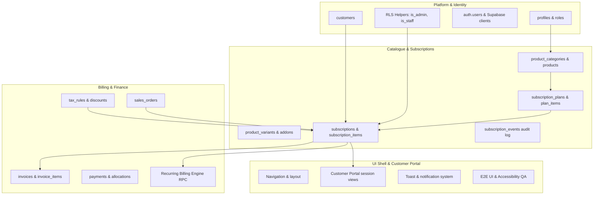
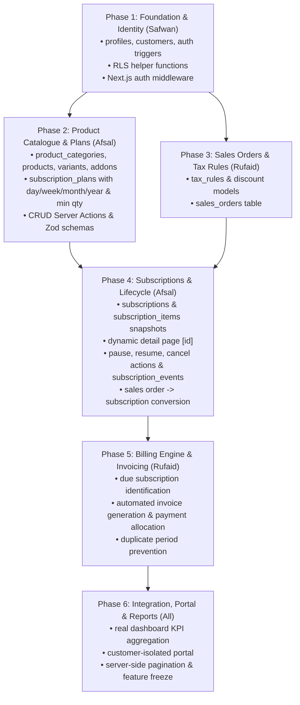

# Brightloop Hub — Complete Problem Statement Gap Audit

**Date:** October 31, 2026  
**Auditor:** Afsal (`feat/afsal-subscriptions`)  
**Project:** Brightloop Hub — Subscription Management System  
**Stack:** Next.js 16 (App Router) + TypeScript + Tailwind CSS v4 + Supabase  

---

## 1. Executive Summary & Existing Architecture

The existing Brightloop Hub repository is an **early-stage frontend prototype**. 

### 1.1 Structural Overview
* **Application Shell & Layout**: Well-structured responsive navigation shell ([`DashboardLayout`](file:///c:/Users/afsal/OneDrive/Desktop/Hackathon/Maketon/make-a-ton/src/components/DashboardLayout.tsx), [`Sidebar`](file:///c:/Users/afsal/OneDrive/Desktop/Hackathon/Maketon/make-a-ton/src/components/Sidebar.tsx), [`TopNav`](file:///c:/Users/afsal/OneDrive/Desktop/Hackathon/Maketon/make-a-ton/src/components/TopNav.tsx)) exposing all 4 primary modules (Management, User, Subscription, Sales).
* **UI Components**: High-quality reusable design system primitives ([`DataTable<T>`](file:///c:/Users/afsal/OneDrive/Desktop/Hackathon/Maketon/make-a-ton/src/components/ui/DataTable.tsx), [`Modal`](file:///c:/Users/afsal/OneDrive/Desktop/Hackathon/Maketon/make-a-ton/src/components/ui/Modal.tsx), [`Badge`](file:///c:/Users/afsal/OneDrive/Desktop/Hackathon/Maketon/make-a-ton/src/components/ui/Badge.tsx), [`StatCard`](file:///c:/Users/afsal/OneDrive/Desktop/Hackathon/Maketon/make-a-ton/src/components/ui/StatCard.tsx)).
* **Data Layer**: 100% of data is imported from in-memory arrays in [`src/data/mockData.ts`](file:///c:/Users/afsal/OneDrive/Desktop/Hackathon/Maketon/make-a-ton/src/data/mockData.ts). Form submissions only append to volatile component state (`useState`) and are lost on page reload.
* **Backend Services & API**: There are **zero** API routes (`src/app/api/`), **zero** Server Actions, and **zero** runtime Zod validation schemas.
* **Database & Auth Integration**: The client wrappers [`src/lib/supabase/client.ts`](file:///c:/Users/afsal/OneDrive/Desktop/Hackathon/Maketon/make-a-ton/src/lib/supabase/client.ts) and [`src/lib/supabase/server.ts`](file:///c:/Users/afsal/OneDrive/Desktop/Hackathon/Maketon/make-a-ton/src/lib/supabase/server.ts) exist and connect successfully to Supabase, but **no application pages call them yet**, and no SQL migrations have been executed on the shared database.

---

## 2. Requirement-by-Requirement Status Matrix

| Area | Requirement | Status | Existing Files Involved | Implementation Reality & Evidence |
|---|---|---|---|---|
| **1. Auth & RBAC** | Unique email registration | **UI only** | [`src/app/auth/register/page.tsx:18-21`](file:///c:/Users/afsal/OneDrive/Desktop/Hackathon/Maketon/make-a-ton/src/app/auth/register/page.tsx#L18-L21) | Form submission only calls `router.push('/dashboard')`. No check for email uniqueness or database insertion. |
| **1. Auth & RBAC** | Password validation (>8 chars, uppercase, lowercase, special) | **Missing** | [`src/app/auth/register/page.tsx:100-112`](file:///c:/Users/afsal/OneDrive/Desktop/Hackathon/Maketon/make-a-ton/src/app/auth/register/page.tsx#L100-L112) | Plain `<input type="password" required />` with no regex, character length, or strength validation. |
| **1. Auth & RBAC** | Login, logout, password reset | **UI only** | [`src/app/auth/login/page.tsx`](file:///c:/Users/afsal/OneDrive/Desktop/Hackathon/Maketon/make-a-ton/src/app/auth/login/page.tsx), [`forgot-password/page.tsx`](file:///c:/Users/afsal/OneDrive/Desktop/Hackathon/Maketon/make-a-ton/src/app/auth/forgot-password/page.tsx), [`TopNav.tsx:88-92`](file:///c:/Users/afsal/OneDrive/Desktop/Hackathon/Maketon/make-a-ton/src/components/TopNav.tsx#L88-L92) | Hardcoded email/password states redirecting to `/dashboard`. Logout in TopNav is an empty button; reset password shows a mock toast. |
| **1. Auth & RBAC** | Admin, Staff & Customer roles | **UI only** | [`src/data/mockData.ts:190-212`](file:///c:/Users/afsal/OneDrive/Desktop/Hackathon/Maketon/make-a-ton/src/data/mockData.ts#L190-L212), [`src/app/users/page.tsx`](file:///c:/Users/afsal/OneDrive/Desktop/Hackathon/Maketon/make-a-ton/src/app/users/page.tsx) | Roles exist solely as display strings (`'Super Admin'`, `'Billing Manager'`, `'Customer'`). No role guards or server authorization helpers exist. |
| **1. Auth & RBAC** | Only admin can create staff | **Missing / Incomplete** | [`src/app/staff/page.tsx:64-94`](file:///c:/Users/afsal/OneDrive/Desktop/Hackathon/Maketon/make-a-ton/src/app/staff/page.tsx#L64-L94) | Any user visiting `/staff` can open the "Add Staff Member" modal and append to local state. No role check or Supabase Admin API invocation. |
| **1. Auth & RBAC** | Customer data isolation (RLS) | **Missing** | Database layer | No RLS policies exist on the database; frontend does not authenticate or isolate session customers. |
| **2. Product Catalogue** | Product CRUD | **Partially Implemented (UI only)** | [`src/app/products/page.tsx`](file:///c:/Users/afsal/OneDrive/Desktop/Hackathon/Maketon/make-a-ton/src/app/products/page.tsx) | Table with search/filter works in-memory. Add modal appends to state. `onEdit` and `onView` are literal `alert()` stubs. |
| **2. Product Catalogue** | Product types, sales price, cost price, notes | **Incomplete** | [`src/app/products/page.tsx:186-196`](file:///c:/Users/afsal/OneDrive/Desktop/Hackathon/Maketon/make-a-ton/src/app/products/page.tsx#L186-L196) | Only a single string `basePrice` (e.g. `"$199.00 / mo"`). Cost price, separate sales price, and internal notes are absent. |
| **2. Product Catalogue** | Product categories | **UI only** | [`src/app/product-categories/page.tsx`](file:///c:/Users/afsal/OneDrive/Desktop/Hackathon/Maketon/make-a-ton/src/app/product-categories/page.tsx) | Category table & modal exist in memory. Product form uses hardcoded `<option>` strings instead of relational category FKs. |
| **2. Product Catalogue** | Product variants & price adjustments | **Incomplete (UI only)** | [`src/app/product-variants/page.tsx`](file:///c:/Users/afsal/OneDrive/Desktop/Hackathon/Maketon/make-a-ton/src/app/product-variants/page.tsx) | Only freeform tier names and flat prices exist. No dynamic attribute key-values (JSONB) or differential price adjustment calculations. |
| **2. Product Catalogue** | Add-on management & billing types | **Partially Implemented (UI only)** | [`src/app/add-ons/page.tsx`](file:///c:/Users/afsal/OneDrive/Desktop/Hackathon/Maketon/make-a-ton/src/app/add-ons/page.tsx) | Add-on catalogue exists in-memory with billing types (`Recurring`, `One-Time`, `Usage-Metered`). Attaching to subscriptions is a non-functional toast banner. |
| **3. Plans** | Daily, weekly, monthly, yearly intervals | **Incomplete** | [`src/app/subscription-plans/page.tsx:189-199`](file:///c:/Users/afsal/OneDrive/Desktop/Hackathon/Maketon/make-a-ton/src/app/subscription-plans/page.tsx#L189-L199) | Dropdown only contains `Monthly`, `Annual`, `Quarterly`. **Daily** and **Weekly** are completely missing. |
| **3. Plans** | Billing interval count & minimum quantity | **Missing** | [`src/app/subscription-plans/page.tsx`](file:///c:/Users/afsal/OneDrive/Desktop/Hackathon/Maketon/make-a-ton/src/app/subscription-plans/page.tsx) | No fields or state exist for `interval_count` (e.g. every 2 weeks) or `minimum_quantity` (e.g. min 5 seats). |
| **3. Plans** | Plan availability dates | **Missing** | [`src/app/subscription-plans/page.tsx`](file:///c:/Users/afsal/OneDrive/Desktop/Hackathon/Maketon/make-a-ton/src/app/subscription-plans/page.tsx) | No date pickers or validation exist for `available_from` or `available_to`. |
| **3. Plans** | Included products / plan items | **Incomplete (UI only)** | [`src/app/subscription-plans/page.tsx:98-107`](file:///c:/Users/afsal/OneDrive/Desktop/Hackathon/Maketon/make-a-ton/src/app/subscription-plans/page.tsx#L98-L107) | Features are stored as a comma-separated list of strings. No structured relational links to catalogue products or variants exist. |
| **3. Plans** | Plan lifecycle: pause, early closure, renewal, expiry settings | **Missing** | [`src/app/subscription-plans/page.tsx:112-117`](file:///c:/Users/afsal/OneDrive/Desktop/Hackathon/Maketon/make-a-ton/src/app/subscription-plans/page.tsx#L112-L117) | "Configure Plan Rules" is an `alert()`. No flags exist for `allow_pause`, `allow_self_cancellation`, or `auto_renew`. |
| **4. Quotes & Subs** | Quotation templates & validity | **UI only** | [`src/app/quotation-templates/page.tsx`](file:///c:/Users/afsal/OneDrive/Desktop/Hackathon/Maketon/make-a-ton/src/app/quotation-templates/page.tsx) | Lists templates with `validDays`. No template line items or variable substitution. |
| **4. Quotes & Subs** | Customer-specific quotations | **UI only** | [`src/app/quotations/page.tsx`](file:///c:/Users/afsal/OneDrive/Desktop/Hackathon/Maketon/make-a-ton/src/app/quotations/page.tsx) | List of proposals with status (`Sent`, `Approved`, `Draft`). Actions (`onView`, `onEdit`) are `alert()` stubs. |
| **4. Quotes & Subs** | Conversion into confirmed sales orders/subscriptions | **Missing** | [`src/app/quotations/page.tsx`](file:///c:/Users/afsal/OneDrive/Desktop/Hackathon/Maketon/make-a-ton/src/app/quotations/page.tsx), [`src/app/sales-orders/page.tsx`](file:///c:/Users/afsal/OneDrive/Desktop/Hackathon/Maketon/make-a-ton/src/app/sales-orders/page.tsx) | No conversion button, workflow, or server action exists to turn an approved quote into a sales order or subscription. |
| **4. Quotes & Subs** | Unique subscription numbers | **Incomplete** | [`src/app/subscriptions/page.tsx:81`](file:///c:/Users/afsal/OneDrive/Desktop/Hackathon/Maketon/make-a-ton/src/app/subscriptions/page.tsx#L81) | Hardcoded client string template `SUB-100${subscriptions.length + 25}`. No database sequence or collision protection. |
| **4. Quotes & Subs** | Subscription line items, taxes & totals | **Incomplete (UI only)** | [`src/app/subscription-details/page.tsx:164-180`](file:///c:/Users/afsal/OneDrive/Desktop/Hackathon/Maketon/make-a-ton/src/app/subscription-details/page.tsx#L164-L180) | Detail view hardcodes static add-ons and prices. No relational line items table or dynamic tax math. |
| **4. Quotes & Subs** | Lifecycle state & event history | **Incomplete (UI only)** | [`src/app/subscription-details/page.tsx:81-111`](file:///c:/Users/afsal/OneDrive/Desktop/Hackathon/Maketon/make-a-ton/src/app/subscription-details/page.tsx#L81-L111) | Pause toggles a local string; Cancel calls `confirm()`. No audit log table or immutable `subscription_events` recorded. |
| **5. Billing & Invoices** | Identify due subscriptions | **Missing** | Backend / Database | No query exists to filter `status = 'active' AND next_billing_date <= CURRENT_DATE`. |
| **5. Billing & Invoices** | Generate invoices automatically | **Missing** | [`src/app/billing-runs/page.tsx:73-87`](file:///c:/Users/afsal/OneDrive/Desktop/Hackathon/Maketon/make-a-ton/src/app/billing-runs/page.tsx#L73-L87) | "Trigger Run" creates a fake mock record with hardcoded counts. No RPC or invoice generator exists. |
| **5. Billing & Invoices** | Tax calculations | **Missing** | [`src/app/tax-templates/page.tsx`](file:///c:/Users/afsal/OneDrive/Desktop/Hackathon/Maketon/make-a-ton/src/app/tax-templates/page.tsx) | Tax templates exist only as display strings (e.g. `5.00%`). No tax calculation engine or rounding logic exists. |
| **5. Billing & Invoices** | Invoice confirm, cancel, send, print | **Missing / Placeholders** | [`src/app/sales-invoices/page.tsx`](file:///c:/Users/afsal/OneDrive/Desktop/Hackathon/Maketon/make-a-ton/src/app/sales-invoices/page.tsx) | Actions are `alert()` stubs. No print layout, cancellation reason modal, or email sending integration exists. |
| **5. Billing & Invoices** | Prevent duplicate/skipped periods | **Missing** | Backend | No billing period key or uniqueness constraint exists to enforce idempotency on repeated billing runs. |
| **6. Discounts** | Fixed & percentage discounts | **UI only** | [`src/app/pricing-rules/page.tsx`](file:///c:/Users/afsal/OneDrive/Desktop/Hackathon/Maketon/make-a-ton/src/app/pricing-rules/page.tsx) | List of rules with discount string (`"16.6%"`, `"20.0%"`). |
| **6. Discounts** | Usage limits & redemption caps | **Missing** | [`src/app/pricing-rules/page.tsx`](file:///c:/Users/afsal/OneDrive/Desktop/Hackathon/Maketon/make-a-ton/src/app/pricing-rules/page.tsx) | No tracking of maximum redemptions, redemptions count, or per-customer limits. |
| **6. Discounts** | Product vs subscription-wide scope | **Incomplete (UI only)** | [`src/app/pricing-rules/page.tsx:168-175`](file:///c:/Users/afsal/OneDrive/Desktop/Hackathon/Maketon/make-a-ton/src/app/pricing-rules/page.tsx#L168-L175) | Freeform text input for "Applicable Target" (`"All Subscription Plans"`). No relational link to products or plans. |
| **6. Discounts** | Automatic application to eligible invoices | **Missing** | Billing engine | No evaluation logic exists to test date, minimum quantity, or scope against an invoice. |
| **7. Payments** | Payment methods, amounts, dates, notes | **UI only** | [`src/app/payment-entries/page.tsx`](file:///c:/Users/afsal/OneDrive/Desktop/Hackathon/Maketon/make-a-ton/src/app/payment-entries/page.tsx) | In-memory table showing mock Stripe/ACH/Visa payments. Modal appends to local array. |
| **7. Payments** | Invoice allocation & status updates | **Missing** | [`src/app/payment-entries/page.tsx`](file:///c:/Users/afsal/OneDrive/Desktop/Hackathon/Maketon/make-a-ton/src/app/payment-entries/page.tsx) | Entering a payment does not update the linked invoice status, balance, or payment history. |
| **7. Payments** | Partial & full payments | **Missing** | Billing engine | Invoices only toggle between mock `Paid` and `Unpaid`. `PARTIALLY_PAID` logic and balance calculations are not implemented. |
| **8. Dashboard & Portal** | MRR, active subs, cash flow metrics | **UI only** | [`src/app/dashboard/page.tsx:33-45`](file:///c:/Users/afsal/OneDrive/Desktop/Hackathon/Maketon/make-a-ton/src/app/dashboard/page.tsx#L33-L45) | Renders static mock numbers (`$243,000`, `4,820`). No aggregation queries exist. |
| **8. Dashboard & Portal** | Financial & movement reports | **UI only** | [`src/app/reports/page.tsx`](file:///c:/Users/afsal/OneDrive/Desktop/Hackathon/Maketon/make-a-ton/src/app/reports/page.tsx) | Hardcoded static table for October-July 2026 movements. Export is an `alert()`. |
| **8. Dashboard & Portal** | Customer portal access & isolation | **Incomplete (UI only)** | [`src/app/customer-portal/page.tsx`](file:///c:/Users/afsal/OneDrive/Desktop/Hackathon/Maketon/make-a-ton/src/app/customer-portal/page.tsx) | Hardcoded to "Acme Technologies Inc. (CUST-501)". Not wired to current authenticated session. |
| **8. Dashboard & Portal** | Scalability with thousands of records | **Partially Implemented (Client-side)** | [`src/components/ui/DataTable.tsx:88-94`](file:///c:/Users/afsal/OneDrive/Desktop/Hackathon/Maketon/make-a-ton/src/components/ui/DataTable.tsx#L88-L94) | Pagination and search are performed in-memory on client arrays (`slice(start, start + pageSize)`). Will break if thousands of records are fetched to the browser. Server-side pagination is missing. |

---

## 3. Existing Functional Features

The following features actually work in the running application right now (at client-side state level):

1. **Client-side Search & Text Filtering**: [`DataTable`](file:///c:/Users/afsal/OneDrive/Desktop/Hackathon/Maketon/make-a-ton/src/components/ui/DataTable.tsx) dynamically filters table rows across all object properties or specific keys as user types in real time.
2. **Client-side Status Filtering**: Category and status dropdown filters on tables successfully reduce the visible dataset.
3. **Client-side Pagination**: Table slices data into pages of 8 items, with previous/next controls and dynamic page count display.
4. **Modal Window Lifecycle**: [`Modal`](file:///c:/Users/afsal/OneDrive/Desktop/Hackathon/Maketon/make-a-ton/src/components/ui/Modal.tsx) properly manages backdrop clicks, escape key dismissals, scroll lock, and portal dialog rendering.
5. **In-Memory Record Appending & Removal**: Submitting forms updates local React `useState` arrays, immediately updating the active table; delete triggers browser `confirm()` and filters state.
6. **Supabase Connectivity Wrapper**: [`src/lib/supabase/client.ts`](file:///c:/Users/afsal/OneDrive/Desktop/Hackathon/Maketon/make-a-ton/src/lib/supabase/client.ts) and [`server.ts`](file:///c:/Users/afsal/OneDrive/Desktop/Hackathon/Maketon/make-a-ton/src/lib/supabase/server.ts) successfully establish authenticated connection to the remote Supabase project.

---

## 4. UI-Only Features (Mock Data Driven)

These pages look visually complete but operate on static mocks and fake navigation:

1. **Authentication Flow**:
   * [`/auth/login`](file:///c:/Users/afsal/OneDrive/Desktop/Hackathon/Maketon/make-a-ton/src/app/auth/login/page.tsx) accepts any input and navigates to `/dashboard`.
   * [`/auth/register`](file:///c:/Users/afsal/OneDrive/Desktop/Hackathon/Maketon/make-a-ton/src/app/auth/register/page.tsx) accepts arbitrary input and redirects to `/dashboard`.
   * [`/auth/forgot-password`](file:///c:/Users/afsal/OneDrive/Desktop/Hackathon/Maketon/make-a-ton/src/app/auth/forgot-password/page.tsx) shows a timed notification banner.
2. **Administration & Staff**:
   * [`/staff`](file:///c:/Users/afsal/OneDrive/Desktop/Hackathon/Maketon/make-a-ton/src/app/staff/page.tsx) and [`/users`](file:///c:/Users/afsal/OneDrive/Desktop/Hackathon/Maketon/make-a-ton/src/app/users/page.tsx) display static arrays from `mockData.ts`.
3. **Catalogue & Plans**:
   * [`/products`](file:///c:/Users/afsal/OneDrive/Desktop/Hackathon/Maketon/make-a-ton/src/app/products/page.tsx), [`/product-categories`](file:///c:/Users/afsal/OneDrive/Desktop/Hackathon/Maketon/make-a-ton/src/app/product-categories/page.tsx), [`/product-variants`](file:///c:/Users/afsal/OneDrive/Desktop/Hackathon/Maketon/make-a-ton/src/app/product-variants/page.tsx), [`/add-ons`](file:///c:/Users/afsal/OneDrive/Desktop/Hackathon/Maketon/make-a-ton/src/app/add-ons/page.tsx), and [`/subscription-plans`](file:///c:/Users/afsal/OneDrive/Desktop/Hackathon/Maketon/make-a-ton/src/app/subscription-plans/page.tsx).
4. **Sales & Billing Operations**:
   * [`/quotations`](file:///c:/Users/afsal/OneDrive/Desktop/Hackathon/Maketon/make-a-ton/src/app/quotations/page.tsx), [`/sales-orders`](file:///c:/Users/afsal/OneDrive/Desktop/Hackathon/Maketon/make-a-ton/src/app/sales-orders/page.tsx), [`/sales-invoices`](file:///c:/Users/afsal/OneDrive/Desktop/Hackathon/Maketon/make-a-ton/src/app/sales-invoices/page.tsx), [`/payment-entries`](file:///c:/Users/afsal/OneDrive/Desktop/Hackathon/Maketon/make-a-ton/src/app/payment-entries/page.tsx), [`/billing-runs`](file:///c:/Users/afsal/OneDrive/Desktop/Hackathon/Maketon/make-a-ton/src/app/billing-runs/page.tsx).
5. **Dashboard & Portal**:
   * [`/dashboard`](file:///c:/Users/afsal/OneDrive/Desktop/Hackathon/Maketon/make-a-ton/src/app/dashboard/page.tsx), [`/reports`](file:///c:/Users/afsal/OneDrive/Desktop/Hackathon/Maketon/make-a-ton/src/app/reports/page.tsx), and [`/customer-portal`](file:///c:/Users/afsal/OneDrive/Desktop/Hackathon/Maketon/make-a-ton/src/app/customer-portal/page.tsx).

---

## 5. Missing Features (Zero Implementation)

1. **Authentication Enforcement & Middleware**:
   * No `middleware.ts` protecting private routes. Unauthenticated visitors can load any URL directly.
2. **Role Authorization**:
   * No role checks or session context. Customer accounts cannot be distinguished from Staff or Admin accounts.
3. **Database Migrations & Tables**:
   * No tables exist in Supabase for business entities (`products`, `subscription_plans`, `subscriptions`, `invoices`, etc.).
4. **Quote-to-Order and Order-to-Subscription Conversion**:
   * No conversion button or transformation logic exists to progress a sales quotation into an active subscription.
5. **Automated Recurring Billing Engine**:
   * No background worker, cron trigger, or database RPC (`run_billing()`) exists to find due subscriptions, generate invoices, or advance `next_billing_date`.
6. **Payment Allocation**:
   * No logic to calculate remaining invoice balances, match payments against invoices, or mark invoices `PARTIALLY_PAID` / `PAID`.
7. **Discount Engine**:
   * No logic to validate coupon codes, evaluate minimum quantity/purchase thresholds, or calculate percentage/fixed reductions on invoice totals.
8. **Server-Side Pagination**:
   * `DataTable` has no props or hooks for `page`, `pageSize`, or `totalCount` backed by database queries (`count: 'exact'`).

---

## 6. Incorrect or Incomplete Implementations

1. **Dynamic Subscription Detail Route Ignores `params.id`**:
   * [`src/app/subscriptions/[id]/page.tsx:1-15`](file:///c:/Users/afsal/OneDrive/Desktop/Hackathon/Maketon/make-a-ton/src/app/subscriptions/%5Bid%5D/page.tsx#L1-L15) re-exports `SubscriptionDetailsPage` directly without accepting or consuming the dynamic `id` route parameter. Navigating to `/subscriptions/SUB-10019` or `/subscriptions/FOO` renders the identical hardcoded view for `SUB-10024`.
2. **Missing Billing Intervals**:
   * Problem statement specifies **daily, weekly, monthly, and yearly**.
   * Plan modal ([`src/app/subscription-plans/page.tsx:195-198`](file:///c:/Users/afsal/OneDrive/Desktop/Hackathon/Maketon/make-a-ton/src/app/subscription-plans/page.tsx#L195-L198)) only lists `Monthly`, `Annual`, `Quarterly`. **Daily** and **Weekly** are missing.
3. **String Money Representation**:
   * Prices across forms and mock data are formatted as formatted strings (`"$149.00 / mo"`, `"$14,400.00"`).
   * Problem statement and financial contract require strict `NUMERIC(12, 2)` decimal money in **INR (₹)** to prevent floating-point calculation drift.
4. **Registration Role Escalation Risk**:
   * Problem statement specifies public registration may only create **Customer** accounts.
   * Current registration page header reads *"Create an administrator account"* ([`register/page.tsx:44`](file:///c:/Users/afsal/OneDrive/Desktop/Hackathon/Maketon/make-a-ton/src/app/auth/register/page.tsx#L44)).
5. **Static Customer Portal**:
   * [`/customer-portal`](file:///c:/Users/afsal/OneDrive/Desktop/Hackathon/Maketon/make-a-ton/src/app/customer-portal/page.tsx) is an admin preview for `"Acme Technologies Inc."`. It does not query the session user's customer record, failing customer data isolation.
6. **Password Validation Missing**:
   * Password input has no validation check enforcing `> 8 characters, uppercase, lowercase, and special character`.

---

## 7. Reusable Components & Primitives

Do **NOT** rebuild these components; wire them to real data and server actions:

| Component | File Path | Capabilities & Hooks to Leverage |
|---|---|---|
| **`DataTable<T>`** | [`src/components/ui/DataTable.tsx`](file:///c:/Users/afsal/OneDrive/Desktop/Hackathon/Maketon/make-a-ton/src/components/ui/DataTable.tsx) | Typed columns with custom `render()`, built-in search input, status filter select, header action bar (`onAddNew`, `onExport`), row actions (`onView`, `onEdit`, `onDelete`), pagination controls. |
| **`Modal`** | [`src/components/ui/Modal.tsx`](file:///c:/Users/afsal/OneDrive/Desktop/Hackathon/Maketon/make-a-ton/src/components/ui/Modal.tsx) | Backdrop blur, escape key listener, scrollable body, accessible close button, custom footer actions. |
| **`Badge`** | [`src/components/ui/Badge.tsx`](file:///c:/Users/afsal/OneDrive/Desktop/Hackathon/Maketon/make-a-ton/src/components/ui/Badge.tsx) | Preset styling for statuses (`Active`, `Paused`, `Past Due`, `Cancelled`, `Paid`, `Processing`, `Completed`, etc.). |
| **`StatCard`** | [`src/components/ui/StatCard.tsx`](file:///c:/Users/afsal/OneDrive/Desktop/Hackathon/Maketon/make-a-ton/src/components/ui/StatCard.tsx) | Metric value, change pill (`up`, `down`, `neutral`), subtitle period, and dynamic Lucide icon rendering. |
| **`DashboardLayout`** | [`src/components/DashboardLayout.tsx`](file:///c:/Users/afsal/OneDrive/Desktop/Hackathon/Maketon/make-a-ton/src/components/DashboardLayout.tsx) | Desktop fixed sidebar, mobile slide-out drawer, top navigation bar, header title and module badge. |

---

## 8. Module Dependencies & Team Touchpoints

---

## 9. Recommended Implementation Order

---

## 10. Exact Files That Need to Be Created or Modified

### 10.1 Afsal's Module (Catalogue & Subscriptions)

#### Files to Create:
1. `src/types/catalog.ts` — TypeScript interfaces for products, categories, variants, and add-ons.
2. `src/types/subscription.ts` — TypeScript interfaces for plans, plan items, subscriptions, subscription items, and events.
3. `src/lib/validations/catalog.ts` — Zod schemas for product, category, variant, and add-on forms.
4. `src/lib/validations/subscription.ts` — Zod schemas for plan configuration and subscription lifecycle actions.
5. `src/lib/billing-dates.ts` — Utility for calculating period start/end, interval offsets (day, week, month, year), and `next_billing_date = period_end + 1 day` in `Asia/Kolkata`.
6. `src/app/actions/catalog.ts` — Server actions for catalogue CRUD mutations against Supabase.
7. `src/app/actions/subscriptions.ts` — Server actions for subscription creation, pause, resume, cancellation, and sales order conversion.
8. `supabase/drafts/002_catalog_plans.sql` — Draft migration for categories, products, variants, add-ons, and plans.
9. `supabase/drafts/004_subscriptions.sql` — Draft migration for subscriptions, items, sequence, and events.

#### Files to Modify:
1. [`src/app/products/page.tsx`](file:///c:/Users/afsal/OneDrive/Desktop/Hackathon/Maketon/make-a-ton/src/app/products/page.tsx) — Replace mock array with server data fetch and wired CRUD actions; add cost price and sales price fields.
2. [`src/app/product-categories/page.tsx`](file:///c:/Users/afsal/OneDrive/Desktop/Hackathon/Maketon/make-a-ton/src/app/product-categories/page.tsx) — Connect to live `product_categories` table; populate dynamic select in product form.
3. [`src/app/product-variants/page.tsx`](file:///c:/Users/afsal/OneDrive/Desktop/Hackathon/Maketon/make-a-ton/src/app/product-variants/page.tsx) — Add dynamic JSONB attribute builder and differential price adjustment field.
4. [`src/app/add-ons/page.tsx`](file:///c:/Users/afsal/OneDrive/Desktop/Hackathon/Maketon/make-a-ton/src/app/add-ons/page.tsx) — Connect to live `addons` table.
5. [`src/app/subscription-plans/page.tsx`](file:///c:/Users/afsal/OneDrive/Desktop/Hackathon/Maketon/make-a-ton/src/app/subscription-plans/page.tsx) — Add `Daily` and `Weekly` options, `minimum_quantity`, `interval_count`, availability dates, and edit modal.
6. [`src/app/subscriptions/page.tsx`](file:///c:/Users/afsal/OneDrive/Desktop/Hackathon/Maketon/make-a-ton/src/app/subscriptions/page.tsx) — Connect table to Supabase `subscriptions` table; load real customers and plans in modal.
7. [`src/app/subscriptions/[id]/page.tsx`](file:///c:/Users/afsal/OneDrive/Desktop/Hackathon/Maketon/make-a-ton/src/app/subscriptions/%5Bid%5D/page.tsx) — Read `params.id`, fetch specific subscription record, line items, and event timeline.
8. [`src/app/subscription-details/page.tsx`](file:///c:/Users/afsal/OneDrive/Desktop/Hackathon/Maketon/make-a-ton/src/app/subscription-details/page.tsx) — Convert into reusable detail view component accepting live data, pause/resume server action, and add-on attachment.
9. [`src/app/sales-orders/page.tsx`](file:///c:/Users/afsal/OneDrive/Desktop/Hackathon/Maketon/make-a-ton/src/app/sales-orders/page.tsx) — Add "Convert to Subscription" button and trigger.

### 10.2 Other Teammate Deliverables (Coordination Reference)

* **Safwan (Platform)**:
  * `middleware.ts` (Next.js route protection and session token refresh).
  * `001_core_identity.sql` (`profiles`, `customers`, RLS helpers).
  * `src/app/auth/login/page.tsx` & `register/page.tsx` wired to Supabase Auth.
* **Rufaid (Finance)**:
  * `003_sales_orders_tax.sql` (`tax_rules`, `sales_orders`).
  * `005_invoicing_billing.sql` (`invoices`, `payments`, billing RPC).
  * `src/app/sales-invoices/page.tsx` & `billing-runs/page.tsx` live wiring.
* **Mishal (UI / Portal)**:
  * Wire `/customer-portal` to session customer's subscriptions.
  * Wire `/dashboard` to live database count / sum aggregates.

---

## 11. Risks & Integration Conflicts Between Teammates

1. **Foreign Key Deadlock Between Subscriptions and Sales Orders**:
   * *Risk*: Subscriptions reference `source_sales_order_id` (Rufaid), while Sales Orders may reference `subscription_id` or Quotations.
   * *Mitigation*: Make `source_sales_order_id` strictly nullable (`REFERENCES sales_orders(id) ON DELETE SET NULL`). Do not apply unique index on it until Rufaid confirms 1:1 vs 1:N cardinality.
2. **Tax Snapshot Timing Mismatch**:
   * *Risk*: If Afsal's subscription items freeze a tax rate, but Rufaid's billing engine recalculates tax at invoice generation time using dynamic tax rules, values will conflict.
   * *Mitigation*: Follow agreed financial contract: `subscription_items.tax_rate_snapshot` serves as indicative default rate, but Rufaid's `invoice_items` is authoritative for legal invoice line taxes.
3. **Draft Subscriptions Inadvertently Billed**:
   * *Risk*: A subscription in `draft` status might be picked up by Rufaid's recurring billing worker.
   * *Mitigation*: Partial database index `CREATE INDEX idx_subscriptions_next_billing_active ON subscriptions (next_billing_date) WHERE status = 'active';` and strict WHERE clause in the billing RPC (`status = 'active'`).
4. **Client-Side Floating Point Precision Drift**:
   * *Risk*: Performing money math with JavaScript `Number` causes IEEE 754 precision errors (e.g. `0.1 + 0.2 = 0.30000000000000004`).
   * *Mitigation*: Store all currency in `NUMERIC(12, 2)` (INR) and perform calculations on the server using integer cents/paise or decimal-safe utilities.
5. **Concurrent Schema Migration Conflicts**:
   * *Risk*: Teammates attempting to apply SQL migrations directly to the shared Supabase instance could overwrite or break shared tables.
   * *Mitigation*: Enforce team rule: Only Safwan runs migrations on the shared database. Afsal and Rufaid provide reviewed SQL scripts in `supabase/drafts/`.

---

## 12. Acceptance Criteria by Implementation Phase

### Phase 1: Authentication & Access Control (Safwan)
- [ ] User can register with unique email; password rejected if $< 8$ chars or missing upper/lower/special characters.
- [ ] Public registration creates only a `CUSTOMER` account; `STAFF` can only be created by an authenticated `ADMIN`.
- [ ] Unauthenticated requests to `/dashboard`, `/subscriptions`, or `/products` redirect to `/auth/login`.

### Phase 2: Catalogue & Plan Management (Afsal)
- [ ] Admin/staff can create, view, edit, and deactivate products with distinct `sales_price` and `cost_price`.
- [ ] Product categories are dynamically selectable and prevent deletion when active products are assigned.
- [ ] Product variants enforce that selected variant belongs to parent product and correctly calculates price adjustments.
- [ ] Subscription plans support `Daily`, `Weekly`, `Monthly`, and `Yearly` cadences, with `minimum_quantity`, `interval_count`, and availability date limits.

### Phase 3: Subscription Creation & Line Items (Afsal)
- [ ] Subscription can be created from plan or converted from approved quotation / sales order.
- [ ] Automatically generates unique formatted number (e.g. `SUB-2026-00001`).
- [ ] Line items freeze item name, SKU, unit price, and add-on billing type snapshot.
- [ ] Navigating to `/subscriptions/[id]` loads the exact subscription matching `params.id` with line items.

### Phase 4: Lifecycle Transitions & Audit History (Afsal)
- [ ] Pausing an active subscription sets `status = 'paused'`, sets `paused_at = now()`, excludes it from billing, and writes a `PAUSED` event to `subscription_events`.
- [ ] Resuming a paused subscription recalculates `current_period_end` and `next_billing_date` shifted forward by pause duration, sets `status = 'active'`, and writes a `RESUMED` event.
- [ ] Cancelling a subscription sets `status = 'cancelled'`, logs reason, and preserves historical records (`ON DELETE RESTRICT`).

### Phase 5: Billing & Invoicing (Rufaid)
- [ ] Nightly billing batch identifies all subscriptions where `status = 'active' AND next_billing_date <= CURRENT_DATE`.
- [ ] Generates invoice snapshot lines with correct tax calculations; advances `next_billing_date = current_period_end + 1 day`.
- [ ] Running the billing job twice for the same period generates zero duplicate invoices.
- [ ] Payments can be logged against invoices, updating balances and transitioning status to `PARTIALLY_PAID` or `PAID`.

### Phase 6: Customer Portal & Dashboards (Mishal & All)
- [ ] Customer login loads `/customer-portal` showing strictly their own subscriptions, invoices, and payments.
- [ ] Customer cannot view or modify another customer's subscription by altering the URL.
- [ ] Dashboard KPI cards reflect live aggregate database queries instead of static mocks.
