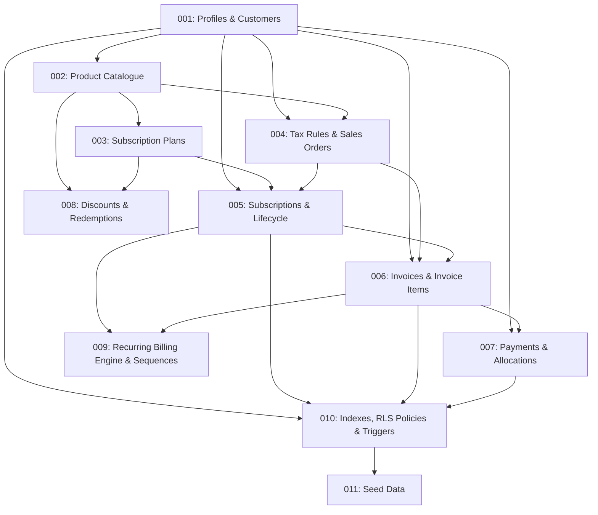

# Brightloop Hub — Comprehensive Implementation Plan & Architecture Roadmap

**Version:** 1.0.0  
**Date:** October 31, 2026  
**Repository Branch:** `feat/afsal-subscriptions`  
**Stack:** Next.js 16 App Router · TypeScript · Supabase (PostgreSQL & Auth) · Tailwind CSS v4 · shadcn/ui · decimal.js

---

## 1. Executive Summary & Current State Audit

Brightloop Hub is a complete subscription management platform for Brightloop Software, uniting product catalogue, subscription lifecycle, quotations, sales orders, recurring billing, invoices, payments, discounts, customer self-service portal, and executive analytics into a unified modular monolith.

### 1.1 Project Structure & Existing Assets
- **Application Framework:** Next.js 16.4.3 App Router with Turbopack, React 19, TypeScript.
- **UI & Components:** Custom design system built with Tailwind CSS v4 and shadcn/ui primitives ([`DataTable`](file:///c:/Users/afsal/OneDrive/Desktop/Hackathon/Maketon/make-a-ton/src/components/ui/DataTable.tsx), [`Modal`](file:///c:/Users/afsal/OneDrive/Desktop/Hackathon/Maketon/make-a-ton/src/components/ui/Modal.tsx), [`Badge`](file:///c:/Users/afsal/OneDrive/Desktop/Hackathon/Maketon/make-a-ton/src/components/ui/Badge.tsx), [`StatCard`](file:///c:/Users/afsal/OneDrive/Desktop/Hackathon/Maketon/make-a-ton/src/components/ui/StatCard.tsx)).
- **Navigation & Layout:** Responsive shell with [`DashboardLayout`](file:///c:/Users/afsal/OneDrive/Desktop/Hackathon/Maketon/make-a-ton/src/components/DashboardLayout.tsx), [`Sidebar`](file:///c:/Users/afsal/OneDrive/Desktop/Hackathon/Maketon/make-a-ton/src/components/Sidebar.tsx), and [`TopNav`](file:///c:/Users/afsal/OneDrive/Desktop/Hackathon/Maketon/make-a-ton/src/components/TopNav.tsx).
- **Supabase Clients:** Configured in [`src/lib/supabase/client.ts`](file:///c:/Users/afsal/OneDrive/Desktop/Hackathon/Maketon/make-a-ton/src/lib/supabase/client.ts) (browser client) and [`src/lib/supabase/server.ts`](file:///c:/Users/afsal/OneDrive/Desktop/Hackathon/Maketon/make-a-ton/src/lib/supabase/server.ts) (server client with cookie persistence via `@supabase/ssr`).
- **Database Status:** Connected to the hosted Supabase project (`fhlswcombzipnzlcnxkx.supabase.co`). Inspection confirmed the `public.profiles` table exists and contains 8 user profiles (2 admins, 4 staff members, 2 customer accounts). All other application tables (`customers`, `products`, `subscriptions`, `invoices`, `payments`, etc.) must be created from scratch.

### 1.2 Module Ownership & Boundaries
- **Safwan Muhammed:** Shared platform, authentication foundation, profiles, customers, authorization helpers, shared permissions, RLS conventions.
- **Afsal:** Product catalogue (categories, products, variants, add-ons), subscription plans, plan items, subscriptions, subscription items, subscription events, lifecycle transitions.
- **Rufaid:** Quotation templates, quotations, quotation items, sales orders, tax rules, invoices, invoice items, payments, billing engine.
- **Mishal:** Executive dashboard, customer portal, reports, analytics, integration QA.

---

## 2. Database Migration Blueprint (Dependency Order)

To guarantee relational integrity and prevent circular foreign key locks, migrations are ordered strictly by dependency:

### Migration Summary Table

| Sequence | Migration File | Target Tables & Objects | Description |
|---|---|---|---|
| **Phase 1** | `001_shared_profiles_and_customers.sql` | `profiles`, `customers` | Ensures `profiles` is aligned; creates `customers` with `user_id -> auth.users.id`. |
| **Phase 2** | `002_product_catalogue.sql` | `product_categories`, `products`, `product_variants`, `add_ons` | Base catalogue, SKU uniqueness, composite key `(id, product_id)` for variant integrity. |
| **Phase 3** | `003_subscription_plans.sql` | `subscription_plans`, `plan_items`, `plan_features` | Standard packages, intervals (daily, weekly, monthly, annual), composite foreign key to variants. |
| **Phase 4** | `004_tax_rules_and_sales_orders.sql` | `tax_rules`, `quotation_templates`, `quotations`, `quotation_items`, `sales_orders`, `sales_order_items` | GST/VAT tax rules, quote generation, sales order workflow. |
| **Phase 5** | `005_subscriptions_and_lifecycle.sql` | `subscriptions`, `subscription_items`, `subscription_addons`, `subscription_events` | Subscription contracts, immutable price snapshots, append-only event audit trail. |
| **Phase 6** | `006_invoices.sql` | `invoices`, `invoice_items` | Recurring & one-time invoices, line-level tax/discount snapshots, idempotency key. |
| **Phase 7** | `007_payments.sql` | `payments`, `payment_allocations` | Multi-method payments (bank, UPI, card, cash), partial & full invoice allocations. |
| **Phase 8** | `008_discounts.sql` | `discounts`, `discount_redemptions` | Fixed & percentage discounts, usage limits, customer redemption caps. |
| **Phase 9** | `009_billing_engine.sql` | Sequences (`SUB-`, `INV-`, `SO-`), `billing_runs`, `process_due_subscriptions()` | Autonomous recurring billing engine with atomic period advancement and duplicate protection. |
| **Phase 10** | `010_indexes_and_rls.sql` | Indexes, RLS policies, `set_updated_at()` trigger | Composite performance indexes, role-based security (`admin`, `staff`, `customer`), strict customer data isolation. |
| **Phase 11** | `011_seed_data.sql` | Seed records for all modules | Prepopulates demonstration data linked to existing admin/staff/customer profiles. |

---

## 3. Implementation Phases & Milestones

### Phase 1: Supabase Foundation & Shared Contracts
- Review and verify environment variables (`NEXT_PUBLIC_SUPABASE_URL`, `NEXT_PUBLIC_SUPABASE_ANON_KEY`, `SUPABASE_SERVICE_ROLE_KEY`).
- Implement privileged admin client in `src/lib/supabase/admin.ts` with `server-only` boundary protection.
- Establish shared TypeScript types in `src/lib/types/database.ts`.
- Prepare all 11 SQL migration files in `supabase/migrations/`.
- Present migration files and RLS policies for approval.

### Phase 2: Product Catalogue Management
- Connect [`src/app/product-categories/page.tsx`](file:///c:/Users/afsal/OneDrive/Desktop/Hackathon/Maketon/make-a-ton/src/app/product-categories/page.tsx) to real Supabase actions.
- Connect [`src/app/products/page.tsx`](file:///c:/Users/afsal/OneDrive/Desktop/Hackathon/Maketon/make-a-ton/src/app/products/page.tsx) to real Supabase actions with category relation.
- Connect [`src/app/product-variants/page.tsx`](file:///c:/Users/afsal/OneDrive/Desktop/Hackathon/Maketon/make-a-ton/src/app/product-variants/page.tsx) with parent product selection and price adjustments.
- Connect [`src/app/add-ons/page.tsx`](file:///c:/Users/afsal/OneDrive/Desktop/Hackathon/Maketon/make-a-ton/src/app/add-ons/page.tsx) with billing types (`recurring`, `one_time`, `usage_metered`).
- Implement CSV export and Zod input validation schemas.

### Phase 3: Subscription Plan Management
- Connect [`src/app/subscription-plans/page.tsx`](file:///c:/Users/afsal/OneDrive/Desktop/Hackathon/Maketon/make-a-ton/src/app/subscription-plans/page.tsx) to real database persistence.
- Implement full interval support: Daily, Weekly, Monthly, Quarterly, Semi-Annual, Annual with custom `interval_count`.
- Support plan policies: `allow_pause`, `allow_self_cancellation`, `auto_renew`.
- Manage bundled `plan_items` with variant integrity validation.

### Phase 4: Subscription Lifecycle & Audit Events
- Connect [`src/app/subscriptions/page.tsx`](file:///c:/Users/afsal/OneDrive/Desktop/Hackathon/Maketon/make-a-ton/src/app/subscriptions/page.tsx) and dynamic route [`src/app/subscriptions/[id]/page.tsx`](file:///c:/Users/afsal/OneDrive/Desktop/Hackathon/Maketon/make-a-ton/src/app/subscriptions/%5Bid%5D/page.tsx).
- Implement database-backed sequence for unique numbers (`SUB-2026-00001`).
- Enforce strict pricing snapshots on `subscription_items`.
- Implement transactional lifecycle operations: Pause, Resume, Renew, Cancel, Expire.
- Log append-only audit records to `subscription_events`.

### Phase 5: Quotations & Sales Orders
- Implement quotation templates and quotation generation.
- Implement quotation-to-sales-order conversion preserving original price/tax snapshots.
- Implement sales-order-to-subscription conversion with audit tracking.

### Phase 6: Recurring Billing Engine & Invoices
- Deploy transactional `process_due_subscriptions()` PostgreSQL function.
- Enforce idempotency via unique `idempotency_key = subscription_id:period_start:period_end`.
- Implement API route `/api/billing/run` protected by `CRON_SECRET` or admin session.
- Connect [`src/app/billing-runs/page.tsx`](file:///c:/Users/afsal/OneDrive/Desktop/Hackathon/Maketon/make-a-ton/src/app/billing-runs/page.tsx) and [`src/app/sales-invoices/page.tsx`](file:///c:/Users/afsal/OneDrive/Desktop/Hackathon/Maketon/make-a-ton/src/app/sales-invoices/page.tsx).
- Support printable invoice layout and browser PDF download.

### Phase 7: Taxes, Discounts & Payments
- Manage tax rules (`tax_rules`).
- Implement fixed and percentage discount validation with usage caps and date windows.
- Connect [`src/app/payment-entries/page.tsx`](file:///c:/Users/afsal/OneDrive/Desktop/Hackathon/Maketon/make-a-ton/src/app/payment-entries/page.tsx) to record payments and allocate to invoices.
- Dynamically update invoice payment status: `partially_paid` vs `paid`.

### Phase 8: Authenticated Customer Portal & Executive Dashboard
- Wire [`src/app/customer-portal/page.tsx`](file:///c:/Users/afsal/OneDrive/Desktop/Hackathon/Maketon/make-a-ton/src/app/customer-portal/page.tsx) to authenticated user's linked customer record.
- Enforce customer isolation via RLS: customer can never read another customer's subscriptions or invoices.
- Wire [`src/app/dashboard/page.tsx`](file:///c:/Users/afsal/OneDrive/Desktop/Hackathon/Maketon/make-a-ton/src/app/dashboard/page.tsx) to real database aggregate queries (MRR, active subscriptions, total invoiced vs cash collected).

### Phase 9: End-to-End Testing & Verification
- Test all 6 core business scenarios:
  1. Scenario A: Customer registration → Product → Plan → Quotation → Sales Order → Subscription activation.
  2. Scenario B: Recurring billing execution → Invoice generation → Idempotency on repeated run.
  3. Scenario C: Invoice payment allocation → Partial payment → Full payment settlement.
  4. Scenario D: Subscription pause → Billing skip → Resume → Schedule advancement.
  5. Scenario E: Customer portal session isolation test.
  6. Scenario F: Discount expiry and usage limit exhaustion.
- Run production build (`npm run build`) and verify TypeScript compilation.

---

## 4. Financial & Data Integrity Rules

1. **Monetary Precision:** All amounts stored as `NUMERIC(12, 2)` in PostgreSQL and calculated using `decimal.js` in TypeScript. Never use native JavaScript floating-point arithmetic.
2. **Calendar Rules:** Billing calculations follow Asia/Kolkata calendar dates. Next billing date = `current_period_end + 1 day`.
3. **Price Snapshots:** `subscription_items` and `invoice_items` preserve immutable snapshots of unit prices, variants, discounts, and taxes. Subsequent catalogue edits never alter historical contracts or invoices.
4. **Variant Integrity:** Composite foreign keys `(variant_id, product_id) REFERENCES product_variants(id, product_id)` prevent assigning a variant to an unrelated product.
5. **Billing Idempotency:** Invoices carry unique composite idempotency keys to eliminate double-billing risks.
