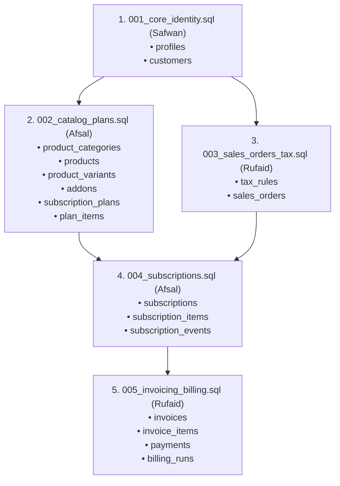

# Product & Subscription Management Module — Database Schema Specification

**Author:** Afsal (`feat/afsal-subscriptions`)  
**Project:** Brightloop Hub  
**Stack:** Next.js 16 + TypeScript + Supabase (PostgreSQL)  
**Status:** Design Phase — Revised Draft (No Migrations Applied)  
**Target Migration Owner:** Safwan (sole authority to apply migrations to shared Supabase project)

---

## 1. Executive Summary & Architecture

This document specifies the authoritative database design for the **Product & Subscription Management** module of Brightloop Hub. It aligns with team conventions and coordinates touchpoints with Safwan (Platform & Identity) and Rufaid (Finance & Billing).

All tables adhere to:
* **UUID primary keys** generated via `gen_random_uuid()`.
* **Lower case plural `snake_case`** table and column names.
* **Timestamps** using `TIMESTAMPTZ` with UTC storage, evaluated with business timezone `Asia/Kolkata`.
* **Calendar billing dates** using `DATE` (inclusive start and end dates).
* **Monetary fields** using `NUMERIC(12, 2)` (never `FLOAT` or floating-point approximations), currency in **INR (₹)**.
* **Audit columns** (`created_at`, `updated_at`, `created_by` referencing `auth.users.id` / `profiles.id`).
* **Row-Level Security (RLS)** enabled on all tables, integrated with Safwan's shared security helpers.
* **Strict Snapshots**: Subscriptions and line items preserve immutable pricing, interval, name, SKU, and billing type snapshots to protect historical audit integrity against future catalogue edits.

---

## 2. Table Ownership & Boundaries

```
[Safwan: Platform & Identity]
  ├── profiles (auth.users extension: role, email, display name)
  └── customers (business accounts: user_id -> auth.users.id)
           │
           │ (customer_id)
           ▼
[Afsal: Catalogue & Subscriptions] ◄────────────┐ (source_sales_order_id)
  ├── product_categories                         │
  ├── products                                   │
  ├── product_variants                           │
  ├── addons                                     │
  ├── subscription_plans                         │
  ├── plan_items                                 │
  ├── subscriptions ─────────────────────────────┼── [Rufaid: Sales & Finance]
  │     ├── subscription_items ──────────────────┘     ├── sales_orders
  │     │     └── (tax_rule_id) ───────────────────────┼── tax_rules
  │     └── subscription_events                        └── invoices
  │           └── (actor_id -> auth.users/profiles)          └── invoice_items
```

### Table Inventory

| Category | Table Name | Description | Direct Dependencies |
|---|---|---|---|
| **Catalogue** | `product_categories` | Hierarchical product taxonomy & groupings | `profiles` |
| **Catalogue** | `products` | Base recurring and standalone product catalogue | `product_categories`, `profiles` |
| **Catalogue** | `product_variants` | Product attributes (JSONB) and price adjustments | `products`, `profiles` |
| **Catalogue** | `addons` | Supplementary recurring or one-time services | `profiles` |
| **Plans** | `subscription_plans` | Standard packages, intervals, and availability windows | `profiles` |
| **Plans** | `plan_items` | Products and variants bundled into a plan | `subscription_plans`, `products`, `product_variants` |
| **Subscriptions** | `subscriptions` | Contract state, billing calendar dates, intervals | `customers`, `subscription_plans`, `sales_orders` (opt) |
| **Subscriptions** | `subscription_items` | Snapshot line items (products or add-ons) | `subscriptions`, `products`, `product_variants`, `addons`, `tax_rules` |
| **Subscriptions** | `subscription_events` | Append-only lifecycle transition audit log | `subscriptions`, `profiles` (nullable) |

---

## 3. Data Dictionary & Table Definitions

### 3.1 Product Catalogue Tables

#### `product_categories`
Organizes subscription services into business categories.
```sql
CREATE TABLE product_categories (
    id UUID PRIMARY KEY DEFAULT gen_random_uuid(),
    name TEXT NOT NULL,
    slug TEXT NOT NULL UNIQUE,
    description TEXT,
    parent_id UUID REFERENCES product_categories(id) ON DELETE SET NULL,
    is_active BOOLEAN NOT NULL DEFAULT true,
    created_at TIMESTAMPTZ NOT NULL DEFAULT now(),
    updated_at TIMESTAMPTZ NOT NULL DEFAULT now(),
    created_by UUID REFERENCES profiles(id) ON DELETE SET NULL
);
```

#### `products`
Root definition for subscription products and standalone licenses.
```sql
CREATE TABLE products (
    id UUID PRIMARY KEY DEFAULT gen_random_uuid(),
    category_id UUID REFERENCES product_categories(id) ON DELETE RESTRICT,
    name TEXT NOT NULL,
    sku TEXT NOT NULL UNIQUE,
    description TEXT,
    type TEXT NOT NULL CHECK (type IN ('recurring_saas', 'usage_metered', 'annual_license', 'one_time')),
    sales_price NUMERIC(12, 2) NOT NULL CHECK (sales_price >= 0),
    cost_price NUMERIC(12, 2) CHECK (cost_price >= 0),
    is_active BOOLEAN NOT NULL DEFAULT true,
    created_at TIMESTAMPTZ NOT NULL DEFAULT now(),
    updated_at TIMESTAMPTZ NOT NULL DEFAULT now(),
    created_by UUID REFERENCES profiles(id) ON DELETE SET NULL
);
```

#### `product_variants`
Configurable attributes and differential pricing for a product.
To ensure that downstream tables (`plan_items`, `subscription_items`) can enforce composite foreign keys, a composite unique constraint on `(product_id, id)` is included.
```sql
CREATE TABLE product_variants (
    id UUID PRIMARY KEY DEFAULT gen_random_uuid(),
    product_id UUID NOT NULL REFERENCES products(id) ON DELETE CASCADE,
    name TEXT NOT NULL,
    code TEXT NOT NULL UNIQUE,
    attributes JSONB NOT NULL DEFAULT '{}'::jsonb,
    price_adjustment NUMERIC(12, 2) NOT NULL DEFAULT 0.00,
    is_active BOOLEAN NOT NULL DEFAULT true,
    created_at TIMESTAMPTZ NOT NULL DEFAULT now(),
    updated_at TIMESTAMPTZ NOT NULL DEFAULT now(),
    created_by UUID REFERENCES profiles(id) ON DELETE SET NULL,
    CONSTRAINT uq_product_variant_name UNIQUE (product_id, name),
    -- Composite unique key to support composite FK integrity from dependent line items
    CONSTRAINT uq_product_variant_composite UNIQUE (product_id, id)
);
```

#### `addons`
Supplementary modular components attachable to customer subscriptions.
```sql
CREATE TABLE addons (
    id UUID PRIMARY KEY DEFAULT gen_random_uuid(),
    name TEXT NOT NULL,
    code TEXT NOT NULL UNIQUE,
    description TEXT,
    unit_price NUMERIC(12, 2) NOT NULL CHECK (unit_price >= 0),
    billing_type TEXT NOT NULL CHECK (billing_type IN ('recurring', 'one_time', 'usage_metered')),
    is_active BOOLEAN NOT NULL DEFAULT true,
    created_at TIMESTAMPTZ NOT NULL DEFAULT now(),
    updated_at TIMESTAMPTZ NOT NULL DEFAULT now(),
    created_by UUID REFERENCES profiles(id) ON DELETE SET NULL
);
```

---

### 3.2 Subscription Plan Tables

#### `subscription_plans`
Defines public or custom subscription tiers, billing cadences, and eligibility.
```sql
CREATE TABLE subscription_plans (
    id UUID PRIMARY KEY DEFAULT gen_random_uuid(),
    name TEXT NOT NULL,
    code TEXT NOT NULL UNIQUE,
    description TEXT,
    billing_interval TEXT NOT NULL CHECK (billing_interval IN ('day', 'week', 'month', 'year')),
    interval_count INTEGER NOT NULL DEFAULT 1 CHECK (interval_count > 0),
    price NUMERIC(12, 2) NOT NULL CHECK (price >= 0),
    minimum_quantity INTEGER NOT NULL DEFAULT 1 CHECK (minimum_quantity > 0),
    available_from DATE,
    available_to DATE,
    is_active BOOLEAN NOT NULL DEFAULT true,
    created_at TIMESTAMPTZ NOT NULL DEFAULT now(),
    updated_at TIMESTAMPTZ NOT NULL DEFAULT now(),
    created_by UUID REFERENCES profiles(id) ON DELETE SET NULL,
    CONSTRAINT chk_plan_availability_dates CHECK (
        available_to IS NULL OR available_from IS NULL OR available_to >= available_from
    )
);
```

#### `plan_items`
Declares which catalogue products/variants are bundled into a standard plan.
Enforces composite foreign key `(product_id, variant_id)` so a variant cannot be assigned without belonging to the parent product.
```sql
CREATE TABLE plan_items (
    id UUID PRIMARY KEY DEFAULT gen_random_uuid(),
    plan_id UUID NOT NULL REFERENCES subscription_plans(id) ON DELETE CASCADE,
    product_id UUID NOT NULL REFERENCES products(id) ON DELETE RESTRICT,
    variant_id UUID,
    quantity INTEGER NOT NULL DEFAULT 1 CHECK (quantity > 0),
    unit_price NUMERIC(12, 2) CHECK (unit_price >= 0), -- Optional override/component price (Decision pending)
    created_at TIMESTAMPTZ NOT NULL DEFAULT now(),
    updated_at TIMESTAMPTZ NOT NULL DEFAULT now(),
    created_by UUID REFERENCES profiles(id) ON DELETE SET NULL,
    CONSTRAINT uq_plan_product_variant UNIQUE (plan_id, product_id, variant_id),
    -- Composite Foreign Key: Guarantees variant belongs to product_id
    CONSTRAINT fk_plan_items_product_variant FOREIGN KEY (product_id, variant_id)
        REFERENCES product_variants (product_id, id) ON DELETE RESTRICT
);
```

> [!NOTE]
> **Plan Pricing Model (Open Decision)**:
> - *Model A (Package Price - Recommended)*: `subscription_plans.price` is the complete bundle price; `plan_items` define quotas/entitlements (e.g. 5 user seats) without individual pricing (`unit_price IS NULL`).
> - *Model B (Component-Based Price)*: Each `plan_items` has an explicit `unit_price`, and plan price is either the sum of items or base fee + components.
> - *Action*: Both options are supported in DDL by making `plan_items.unit_price` nullable. Final decision awaits Rufaid & Safwan alignment.

---

### 3.3 Subscriptions & Lifecycle Tables

#### `subscriptions`
Customer recurring contract instance with billing calendar boundaries.

**Sequence for Subscription Numbering**:
```sql
CREATE SEQUENCE IF NOT EXISTS subscription_number_seq START WITH 1001;

CREATE OR REPLACE FUNCTION generate_subscription_number()
RETURNS TRIGGER AS $$
BEGIN
    IF NEW.subscription_number IS NULL OR NEW.subscription_number = '' THEN
        NEW.subscription_number := 'SUB-' || to_char(CURRENT_DATE, 'YYYY') || '-' || lpad(nextval('subscription_number_seq')::text, 5, '0');
    END IF;
    RETURN NEW;
END;
$$ LANGUAGE plpgsql;
```

```sql
CREATE TABLE subscriptions (
    id UUID PRIMARY KEY DEFAULT gen_random_uuid(),
    subscription_number TEXT NOT NULL UNIQUE,
    customer_id UUID NOT NULL REFERENCES customers(id) ON DELETE RESTRICT,
    plan_id UUID NOT NULL REFERENCES subscription_plans(id) ON DELETE RESTRICT,
    source_sales_order_id UUID REFERENCES sales_orders(id) ON DELETE SET NULL,
    status TEXT NOT NULL DEFAULT 'draft' CHECK (
        status IN ('draft', 'active', 'paused', 'closed', 'cancelled', 'expired')
    ),
    billing_interval TEXT NOT NULL CHECK (billing_interval IN ('day', 'week', 'month', 'year')),
    interval_count INTEGER NOT NULL DEFAULT 1 CHECK (interval_count > 0),
    start_date DATE,
    end_date DATE,
    current_period_start DATE,
    current_period_end DATE,
    next_billing_date DATE,
    activated_at TIMESTAMPTZ,
    paused_at TIMESTAMPTZ,
    closed_at TIMESTAMPTZ,
    cancelled_at TIMESTAMPTZ,
    expired_at TIMESTAMPTZ,
    cancellation_reason TEXT,
    created_at TIMESTAMPTZ NOT NULL DEFAULT now(),
    updated_at TIMESTAMPTZ NOT NULL DEFAULT now(),
    created_by UUID REFERENCES profiles(id) ON DELETE SET NULL,
    -- Draft subscriptions may have unset calendar dates; active/paused/closed MUST have full dates
    CONSTRAINT chk_subscription_dates CHECK (
        status = 'draft' OR (
            start_date IS NOT NULL AND
            current_period_start IS NOT NULL AND
            current_period_end IS NOT NULL AND
            next_billing_date IS NOT NULL AND
            current_period_end >= current_period_start AND
            next_billing_date = current_period_end + INTERVAL '1 day'
        )
    ),
    CONSTRAINT chk_end_after_start CHECK (
        end_date IS NULL OR start_date IS NULL OR end_date >= start_date
    )
);

CREATE TRIGGER trg_generate_sub_number
    BEFORE INSERT ON subscriptions
    FOR EACH ROW
    EXECUTE FUNCTION generate_subscription_number();

-- Partial index for high-performance recurring billing runs (Rufaid's billing engine)
CREATE INDEX idx_subscriptions_next_billing_active 
ON subscriptions (next_billing_date) 
WHERE status = 'active';

-- Foreign key lookup indexes
CREATE INDEX idx_subscriptions_customer ON subscriptions(customer_id);
CREATE INDEX idx_subscriptions_plan ON subscriptions(plan_id);
CREATE INDEX idx_subscriptions_sales_order ON subscriptions(source_sales_order_id);
```

> [!IMPORTANT]
> **Cardinality on `source_sales_order_id`**: A `UNIQUE` constraint on `source_sales_order_id` is intentionally omitted pending Rufaid's confirmation on whether one Sales Order can provision multiple subscriptions.

#### `subscription_items`
Individual line items on an active contract, preserving historical pricing and billing snapshots.
```sql
CREATE TABLE subscription_items (
    id UUID PRIMARY KEY DEFAULT gen_random_uuid(),
    subscription_id UUID NOT NULL REFERENCES subscriptions(id) ON DELETE CASCADE,
    product_id UUID REFERENCES products(id) ON DELETE RESTRICT,
    variant_id UUID,
    addon_id UUID REFERENCES addons(id) ON DELETE RESTRICT,
    tax_rule_id UUID REFERENCES tax_rules(id) ON DELETE SET NULL,
    item_name TEXT NOT NULL,                                       -- Name snapshot
    item_sku TEXT NOT NULL,                                        -- SKU snapshot
    quantity INTEGER NOT NULL CHECK (quantity > 0),
    unit_price NUMERIC(12, 2) NOT NULL CHECK (unit_price >= 0),   -- Price snapshot
    billing_type_snapshot TEXT NOT NULL CHECK (                    -- Add-on billing model snapshot
        billing_type_snapshot IN ('recurring', 'one_time', 'usage_metered')
    ),
    tax_rate_snapshot NUMERIC(5, 2),                              -- Default tax rate snapshot (%)
    tax_name_snapshot TEXT,                                       -- Tax label snapshot
    is_active BOOLEAN NOT NULL DEFAULT true,
    created_at TIMESTAMPTZ NOT NULL DEFAULT now(),
    updated_at TIMESTAMPTZ NOT NULL DEFAULT now(),
    created_by UUID REFERENCES profiles(id) ON DELETE SET NULL,
    -- Target exclusivity: Exactly one of product_id or addon_id
    CONSTRAINT chk_item_target_exclusive CHECK (
        (product_id IS NOT NULL AND addon_id IS NULL) OR
        (product_id IS NULL AND addon_id IS NOT NULL)
    ),
    -- Composite Foreign Key: Guarantees variant belongs to product_id
    CONSTRAINT fk_subscription_items_product_variant FOREIGN KEY (product_id, variant_id)
        REFERENCES product_variants (product_id, id) ON DELETE RESTRICT
);

CREATE INDEX idx_subscription_items_sub ON subscription_items(subscription_id);
```

> [!IMPORTANT]
> **Tax Snapshot Boundary (Subscription vs Invoice)**:
> - **Subscription-level (`tax_rate_snapshot`, `tax_name_snapshot`)**: Represents the agreed baseline tax rate configured for this contract line at creation.
> - **Invoice-level (`invoice_items`)**: Rufaid's billing engine is authoritative for final legally binding invoice snapshots (taxable basis, rounding, dynamic exemptions, and calculated tax amounts).
> - *Action*: Timing of subscription-level snapshot versus runtime resolution is pending Rufaid's review.

#### `subscription_events`
Append-only audit trail capturing lifecycle transitions, pauses, resumes, and automated renewals.
```sql
CREATE TABLE subscription_events (
    id UUID PRIMARY KEY DEFAULT gen_random_uuid(),
    -- RESTRICT prevents accidental cascading deletion of financial audit events
    subscription_id UUID NOT NULL REFERENCES subscriptions(id) ON DELETE RESTRICT,
    actor_id UUID REFERENCES profiles(id) ON DELETE SET NULL, -- NULL indicates system/cron actor
    event_type TEXT NOT NULL CHECK (
        event_type IN ('CREATED', 'ACTIVATED', 'PAUSED', 'RESUMED', 'RENEWED', 'CANCELLED', 'CLOSED', 'EXPIRED', 'PLAN_CHANGED')
    ),
    from_status TEXT,
    to_status TEXT,
    reason TEXT,
    metadata JSONB NOT NULL DEFAULT '{}'::jsonb,
    created_at TIMESTAMPTZ NOT NULL DEFAULT now()
    -- NOTE: Append-only table. No updated_at or updated_by.
);

CREATE INDEX idx_sub_events_sub_id ON subscription_events(subscription_id);
```

> [!CAUTION]
> **Audit Integrity & Deletion Restrictions**: Hard `DELETE` on `subscriptions` is prohibited once audit records or invoices exist (`ON DELETE RESTRICT`). Subscriptions must terminate via lifecycle status transitions (`cancelled`, `closed`, `expired`).

---

## 4. Business Rules & Logic Contracts

### 4.1 Lifecycle Timestamps & State Machine
Valid status states: `draft`, `active`, `paused`, `closed`, `cancelled`, `expired`.

| Status | Meaning & Billability | Relevant Timestamps | Trigger / Origin |
|---|---|---|---|
| `draft` | Unconfirmed proposal / quote staging. **Not billable**. | `created_at` | Initial creation / sales staging |
| `active` | In-force contract with valid calendar dates. **Billable**. | `activated_at` | Client signature, payment confirmation, or admin activation |
| `paused` | Temporarily frozen recurring billing. **Not billable**. | `paused_at` | Customer request, dunning failure, or admin pause |
| `closed` | Contract reached natural conclusion of agreed term. **Not billable**. | `closed_at` | Normal contract completion |
| `cancelled` | Early termination before agreed term end. **Not billable**. | `cancelled_at`, `cancellation_reason` | Customer cancellation or staff breach termination |
| `expired` | End date elapsed without renewal. **Not billable**. | `expired_at` | Automated nightly background worker |

* **Pause Logic**:
  * Set `status = 'paused'`, `paused_at = now()`.
  * Emits event `PAUSED` in `subscription_events`.
* **Resume Logic**:
  * Calculate paused duration: `pause_duration_days = CURRENT_DATE - paused_at::date`.
  * Shift boundaries forward:
    * `current_period_end = current_period_end + pause_duration_days`
    * `next_billing_date = current_period_end + 1 day`
  * Set `status = 'active'`, `paused_at = NULL`.
  * Emits event `RESUMED` in `subscription_events`.

### 4.2 Add-on Billing Behavior in Snapshots
* `recurring`: Invoiced on every recurring cycle.
* `one_time`: Invoiced only on the initial billing run for this subscription, then automatically marked `is_active = false` so subsequent cycles do not re-bill the setup fee.
* `usage_metered`: Billed according to quantity consumed during the active billing period.

### 4.3 Billing Period & Next Billing Date Formula
* **Inclusive dates**: Both `current_period_start` and `current_period_end` are inclusive calendar dates.
* **Interval calculation**:
  * Day: `start + (interval_count) days - 1 day`
  * Week: `start + (interval_count * 7) days - 1 day`
  * Month: `(start + interval_count months) - 1 day`
  * Year: `(start + interval_count years) - 1 day`
* **Next Billing Date**:
  $$\text{next\_billing\_date} = \text{current\_period\_end} + 1\text{ day}$$
* **Timezone**: All midnight date evaluations occur against `Asia/Kolkata`.

---

## 5. Row Level Security (RLS) Policies

All tables must enable RLS:
```sql
ALTER TABLE product_categories ENABLE ROW LEVEL SECURITY;
ALTER TABLE products ENABLE ROW LEVEL SECURITY;
ALTER TABLE product_variants ENABLE ROW LEVEL SECURITY;
ALTER TABLE addons ENABLE ROW LEVEL SECURITY;
ALTER TABLE subscription_plans ENABLE ROW LEVEL SECURITY;
ALTER TABLE plan_items ENABLE ROW LEVEL SECURITY;
ALTER TABLE subscriptions ENABLE ROW LEVEL SECURITY;
ALTER TABLE subscription_items ENABLE ROW LEVEL SECURITY;
ALTER TABLE subscription_events ENABLE ROW LEVEL SECURITY;
```

### Access Policies

> [!NOTE]
> **RLS Helpers Dependency**: The policies below depend on Safwan's shared helper functions (e.g. `is_admin()`, `is_staff()`, or role claims on `auth.users`).

1. **Catalogue & Plans (`products`, `product_variants`, `addons`, `subscription_plans`, `plan_items`, `product_categories`)**:
   * **SELECT**: Public / Authenticated read for all active records (`is_active = true`).
   * **INSERT / UPDATE / DELETE**: Staff and Admin only (via Safwan's role helpers).
2. **Subscriptions (`subscriptions`, `subscription_items`)**:
   * **SELECT (Staff/Admin)**: Full access across all records.
   * **SELECT (Customer)**: Scoped strictly through `customers.user_id = auth.uid()`:
     ```sql
     CREATE POLICY customer_read_own_subscriptions ON subscriptions
     FOR SELECT TO authenticated
     USING (
         customer_id IN (
             SELECT id FROM customers WHERE user_id = auth.uid()
         )
     );

     CREATE POLICY customer_read_own_subscription_items ON subscription_items
     FOR SELECT TO authenticated
     USING (
         subscription_id IN (
             SELECT id FROM subscriptions WHERE customer_id IN (
                 SELECT id FROM customers WHERE user_id = auth.uid()
             )
         )
     );
     ```
   * **INSERT / UPDATE (Staff/Admin)**: Unrestricted.
   * **INSERT / UPDATE (Customer)**: Restricted to self-service plan change actions where permitted by plan flags.
3. **Audit Log (`subscription_events`)**:
   * **SELECT**: Accessible by Staff/Admin and Customers for their own subscriptions.
   * **INSERT**: Server-side actions / automated billing jobs.
   * **UPDATE / DELETE**: Disallowed (append-only table).

---

## 6. Migration Dependency Hierarchy & Phasing



### Migration Status Checklist

* [ ] **Prerequisite 1: `001_core_identity.sql` (Safwan)**: *Pending application*. Creates `profiles` and `customers(id, user_id)`.
* [ ] **Step 2: `002_catalog_plans.sql` (Afsal)**: *Drafted, pending Safwan application*. Self-contained catalogue, variants, add-ons, and subscription plans.
* [ ] **Prerequisite 3: `003_sales_orders_tax.sql` (Rufaid)**: *Pending Rufaid delivery*. Creates `tax_rules` and `sales_orders`.
* [ ] **Step 4: `004_subscriptions.sql` (Afsal)**: *Drafted, pending Safwan application*. Creates `subscriptions`, `subscription_items`, and `subscription_events`.
* [ ] **Follow-up 5: `005_invoicing_billing.sql` (Rufaid)**: *Pending Rufaid delivery*. Invoicing, payment recording, and billing run workers.

---

## 7. Proposed SQL Draft Folder Structure

Draft SQL files will be placed in `supabase/drafts/` (subject to Safwan's confirmation) for peer review:

```text
make-a-ton/
├── PRODUCT_SUBSCRIPTION_SCHEMA.md       # Master specification
├── supabase/
│   ├── drafts/                          # Afsal's reviewed SQL drafts (no migrations executed yet)
│   │   ├── 002_catalog_and_plans.sql    # Stage 1: Categories, products, variants, add-ons, plans
│   │   └── 004_subscriptions.sql        # Stage 2: Subscriptions, items, lifecycle events
│   └── migrations/                      # Official repository migration root (managed by Safwan)
```

---

## 8. Final Approval Checklist

### A. Confirmed Decisions
1. **Primary Keys & Types**: UUID via `gen_random_uuid()`, `TIMESTAMPTZ` for timestamps, `DATE` for billing calendar dates, `NUMERIC(12, 2)` for monetary values (INR).
2. **Composite Variant Integrity**: `product_variants(product_id, id)` composite constraint enforced via foreign key on both `plan_items` and `subscription_items`.
3. **Item Target Exclusivity**: `subscription_items` strictly requires either `product_id` OR `addon_id`.
4. **Draft Subscription Dates**: Dates (`start_date`, `current_period_start`, `current_period_end`, `next_billing_date`) are nullable in `draft` status, but strictly required and validated when `status != 'draft'`.
5. **Next Billing Formula**: $\text{next\_billing\_date} = \text{current\_period\_end} + 1\text{ day}$ in timezone `Asia/Kolkata`.
6. **Audit Event Safety**: `subscription_events.subscription_id` uses `ON DELETE RESTRICT`, and `actor_id` is nullable to accommodate automated billing/expiry cron jobs.
7. **Lifecycle Timestamps**: Explicit tracking of `activated_at`, `paused_at`, `closed_at`, `cancelled_at`, and `expired_at`.
8. **Subscription Number**: Auto-generated via database sequence `subscription_number_seq` and trigger function.

### B. Decisions Awaiting Safwan
1. **Customer User Reference**: Confirmation that `customers.user_id REFERENCES auth.users(id)` is the canonical customer-to-auth relationship.
2. **Shared RLS Helpers**: Availability of `is_admin()` and `is_staff()` functions or claims for role-based policies.
3. **Draft Folder Convention**: Confirmation that `supabase/drafts/` is the approved location for staging unapplied SQL prior to Safwan applying them.

### C. Decisions Awaiting Rufaid
1. **Sales Order Cardinality**: Confirmation whether 1 `sales_orders` record can produce multiple `subscriptions` (confirming omission of `UNIQUE` constraint on `source_sales_order_id`).
2. **Tax Snapshot Timing**: Confirmation on whether `tax_rate_snapshot` on `subscription_items` is sufficient for recurring invoicing, or whether tax calculation is solely resolved at invoice creation time.
3. **Table & Column Naming**: Confirmation of canonical table names `tax_rules(id)` and `sales_orders(id)`.

### D. Decisions Requiring Joint Approval (Afsal, Rufaid, Safwan)
1. **Plan Pricing Model**: Agreement on whether `subscription_plans.price` is purely a package bundle price (Model A), or whether `plan_items` require individual component pricing (Model B).
2. **Migration Application Schedule**: Sequencing PR merges for `001_core_identity` $\rightarrow$ `002_catalog_plans` $\rightarrow$ `003_sales_orders_tax` $\rightarrow$ `004_subscriptions`.
