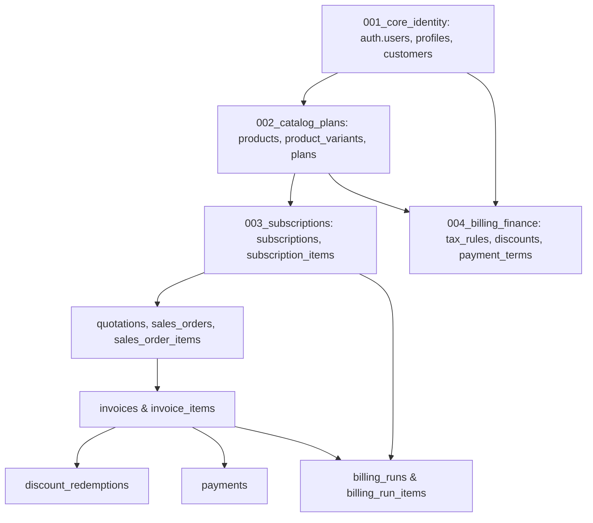

# Sales Module Database Schema & Integration Architecture

**Branch:** `feat/rufaid-billing`  
**Owner:** Rufaid (Sales Module, Invoicing, Pricing, Taxes & Recurring Billing)  
**Reference Document:** `BRIGHTLOOP_MASTER_IMPLEMENTATION_PLAN.md` (Sections 7.5 & 7.7)

---

## 1. Domain Ownership & Architectural Boundaries

As the owner of the **Sales Module**, all financial, quoting, ordering, discounting, tax, invoicing, payment, and recurring billing run logic resides in this isolated domain.

To maintain modularity and avoid breaking team workflows:
1. **User Module (Safwan):** Tables `profiles` and `customers` are referenced solely as external integration contracts via stable foreign keys (`REFERENCES customers(id)` and `REFERENCES profiles(id)`). No modifications are made to their domain tables.
2. **Subscription Module (Afsal):** Tables `products`, `product_variants`, `plans`, and `subscriptions` are referenced through foreign keys (`REFERENCES subscriptions(id)`, etc.).
3. **Sales Module (Rufaid):** Owns `tax_rules`, `discounts`, `discount_products`, `discount_redemptions`, `payment_terms`, `quotation_templates`, `quotation_template_items`, `quotations`, `quotation_items`, `sales_orders`, `sales_order_items`, `invoices`, `invoice_items`, `payments`, `billing_runs`, and `billing_run_items`.

---

## 2. SQL Dependency Ordering & Clean Database Execution

When executing migrations sequentially on a clean PostgreSQL database, circular dependencies and forward-reference errors are prevented by strictly ordering the DDL sequence:



### Table Creation Order in `004_billing_finance.sql`:
1. **Enums:** `discount_type`, `discount_scope`, `discount_redemption_status`, `quotation_status`, `sales_order_status`, `invoice_status`, `invoice_kind`, `payment_method`, `payment_status`, `billing_run_status`, `billing_run_item_status`.
2. **Independent Configuration:**
   - `tax_rules` (no FK)
   - `discounts` (no FK)
   - `discount_products` (FK: `discounts`, `products`)
   - `payment_terms` (no FK)
3. **Quotation Layer:**
   - `quotation_templates` (no FK)
   - `quotation_template_items` (FK: `quotation_templates`, `products`, `plans`)
   - `quotations` (FK: `customers`, `payment_terms`, `quotation_templates`)
   - `quotation_items` (FK: `quotations`, `products`, `product_variants`, `tax_rules`)
4. **Sales Order Layer:**
   - `sales_orders` (FK: `customers`, `quotations`, `payment_terms`)
   - `sales_order_items` (FK: `sales_orders`, `products`, `product_variants`, `tax_rules`, `discounts`) — *Preserves line items, variants, unit prices, discounts, and taxes for subscription & invoice conversion.*
5. **Invoicing Layer:**
   - `invoices` (FK: `customers`, `subscriptions`, `sales_orders`, `payment_terms`, `replaces_invoice_id`)
   - `invoice_items` (FK: `invoices`, `products`, `product_variants`, `tax_rules`, `discounts`)
6. **Redemptions & Payments:**
   - `discount_redemptions` (FK: `discounts`, `customers`, `invoices`, `quotations`) — *Created after both quotations and invoices exist to avoid forward reference.*
   - `payments` (FK: `invoices`, `customers`, `reversed_payment_id`)
7. **Recurring Billing Engine History:**
   - `billing_runs` (FK: `profiles`)
   - `billing_run_items` (FK: `billing_runs`, `subscriptions`, `invoices`)
8. **Indexes, Triggers & RLS Policies.**

---

## 3. Recurring Invoice Idempotency & Replacement Policy

To ensure that the automated recurring billing cron and manual runs cannot create duplicate invoices for the same subscription period:

1. **Unconditional Partial Unique Index:**
   ```sql
   CREATE UNIQUE INDEX uq_recurring_subscription_period
     ON invoices (subscription_id, billing_period_start, billing_period_end)
     WHERE invoice_kind = 'RECURRING';
   ```
   *Rationale:* By removing `AND status != 'CANCELLED'`, the recurring scheduler is unconditionally prevented from silently re-billing a period where an invoice was previously generated and cancelled.

2. **Explicit Replacement Policy:**
   If a cancelled recurring invoice must be re-issued following a customer correction, the new invoice must explicitly set `replaces_invoice_id = <original_invoice_id>` with `invoice_kind = 'STANDARD'` (or specialized adjustment type), preserving total audit immutability.

3. **Integrity Precondition Constraint:**
   ```sql
   CONSTRAINT chk_recurring_invoice_fields CHECK (
     invoice_kind != 'RECURRING' OR (
       subscription_id IS NOT NULL AND
       billing_period_start IS NOT NULL AND
       billing_period_end IS NOT NULL
     )
   );
   ```

---

## 4. Invoice Consistency & Payment Reconciliation

1. **Mathematical Invariant Constraints:**
   - `CHECK (balance = total_amount - paid_amount)`
   - `CHECK (paid_amount <= total_amount)` (prevents accidental overpayment)
   - `CHECK (status != 'CANCELLED' OR paid_amount = 0)`
2. **Payment Immutability & Reversals:**
   - Payments are append-only.
   - Column `payment_type`: `'PAYMENT'`, `'REFUND'`, `'REVERSAL'`.
   - Column `reversed_payment_id REFERENCES payments(id)`.
3. **Reconciliation Trigger (`reconcile_invoice_on_payment`):**
   - Attached to `payments` for `AFTER INSERT OR UPDATE OR DELETE`.
   - Uses `SELECT ... FOR UPDATE` on `invoices` to serialize concurrent payments and prevent race condition overpayments.
   - Computes:
     ```sql
     SELECT COALESCE(SUM(
       CASE WHEN payment_type = 'PAYMENT' THEN amount ELSE -amount END
     ), 0.00) INTO v_total_paid
       FROM payments
      WHERE invoice_id = v_invoice_id AND status = 'SUCCESS';
     ```
   - Recomputes `paid_amount` and `balance`.
   - Automatically transitions status:
     - `paid_amount >= total_amount` → `PAID`
     - `paid_amount > 0` → `PARTIALLY_PAID`
     - `paid_amount = 0` → `CONFIRMED`
   - Raises an exception if a transaction causes `paid_amount > total_amount`.

---

## 5. Discount Usage & Redemptions

- **Lifecycle:** `RESERVED` → `CONSUMED` (or `RELEASED` if invoice/order cancelled).
- **Concurrency Safety:** Enforced via atomic transactional decrement:
  ```sql
  UPDATE discounts
     SET current_usage = current_usage + 1
   WHERE id = $1
     AND is_active = TRUE
     AND (usage_limit IS NULL OR current_usage < usage_limit)
  RETURNING id;
  ```

---

## 6. INR Currency Standardization

- Standard Currency: **INR (`₹`)** throughout database and frontend.
- Formatting: `en-IN` locale (`₹1,000.00`, `₹25,000.00`, `₹1,50,000.00`, `₹10,00,000.00`).
- Database Storage: `NUMERIC(12, 2)` for amounts, `NUMERIC(6, 4)` for tax/discount rates.
- Financial Calculations: `decimal.js` with `ROUND_HALF_UP` precision 28. No floating-point math.

---

## 7. Migration Execution Guide

To run on a clean PostgreSQL database:

```bash
# In sequential order:
psql -d <db_name> -f supabase/migrations/001_core_identity.sql
psql -d <db_name> -f supabase/migrations/002_catalog_plans.sql
psql -d <db_name> -f supabase/migrations/003_subscriptions.sql
psql -d <db_name> -f supabase/migrations/004_billing_finance.sql
```

Verification test suite:
```bash
npm test
```
Runs 28 tests verifying:
- Financial math (`decimal.js`)
- Billing intervals & anchor calculations (`Asia/Kolkata`)
- SQL DDL dependency ordering, constraints, partial unique index, and RLS policies
